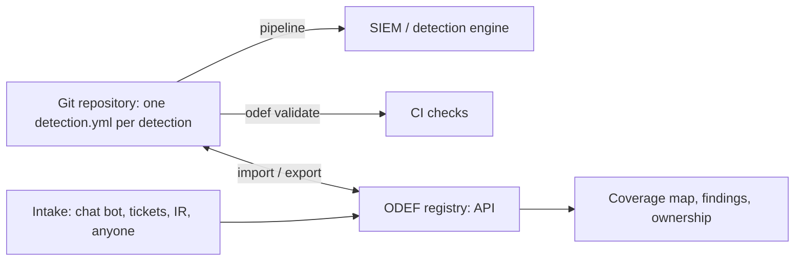

+++
title = "Platform"
chapter = false
weight = 34
draft = false
+++

### The reference platform

The YAML schema and the pipeline are enough to run Detection as Code with nothing but a Git repository and a CI runner. What they do not give you is a validator every team would otherwise write for itself, and a place to look: a registry where anyone in the company can see what is detected, by whom, in what state, and where the gaps are.

ODEF ships both as one open source package: **[odef-platform on GitHub](https://github.com/open-detection-engineering-framework/odef-platform)**, MIT licensed, Python.

### Where it sits

The repository stays the source of truth and the pipeline stays the only path to production. The platform never talks to the SIEM. It is a registry on top: it imports the YAML, exposes it through an API, and gives the Detection Strategy layer its inputs. A change made in the registry is exported back to the repository as a file and goes through the same pull request as everything else.

### What it does today

**The schema as code.** The [reference schema]({}) is a set of Pydantic models, and a JSON Schema is generated from them. Editors that understand JSON Schema validate `detection.yml` as you type.

**The validator the pipeline calls.** `odef validate` runs the schema plus the rules under "What CI should check": duplicate or changed ids, logic changes without a version bump (by diffing against a git ref), expired exceptions, data sources missing from the data dictionary, and warnings for overdue reviews, midday detections without a canary or runbook, and detections with no ATT&CK mapping. The [pipeline example]({}) can call it instead of a hand-written script.

**A registry with an API.** `odef import` loads a repository into SQLite or PostgreSQL. `odef serve` exposes it: list and filter detections by status, type, and owner, fetch one as JSON or as `detection.yml`, run the checks for one or all detections, and a coverage endpoint that maps ATT&CK techniques to the detections that claim them, with confidence.

### Roadmap

1. **Deployer.** Export a registry change as a pull request to the detection repository.
2. **Health.** Ingest canary, drift, and exception findings from the nightly job and show them per owner.
3. **Intake.** A queue any source can write to through the API, triaged into the strategy backlog.
4. **Web UI** over the API, starting with the coverage map.

### Design constraints

* **Registry, not engine.** The platform never talks to the SIEM. The pipeline does. This keeps the platform vendor-neutral and keeps production credentials out of a web application.
* **Files win.** If the registry and the repository disagree, the repository is right and the registry re-imports. There is no state that lives only in the database.
* **API first.** Every future UI action is an API call, so the chat bot, the ticket board, and the pipeline are all clients of the same thing.
* **Small enough to run on a laptop.** One package, one SQLite file, one command.

### Contributing

Issues follow the roadmap. If you run ODEF in your own environment and have a schema extension, a deployer for your platform, or an intake source to share, that is the contribution the project needs most.
